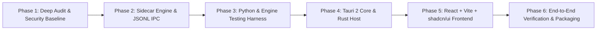

# MediaDock — Phase-by-Phase Migration Plan

## 1. Migration Goals & Boundaries
The MediaDock migration transforms `yt_dlp_backend` into a modern cross-platform desktop application powered by **Tauri 2 + Rust** and **React + TypeScript + Vite**, utilizing the Python backend engine via **structured JSON Lines IPC over stdio**.

All existing server code (FastAPI, Alembic, Celery) is preserved in-place so server-mode workflows continue to function while the desktop runtime operates independently with zero Redis/Celery dependency.

---

## 2. Component Migration Matrix

| Component | Current Role | MediaDock Strategy | Action Required |
|---|---|---|---|
| `app/services/yt_service.py` | yt-dlp core wrapper | Core Media Engine | **REFACTOR:** Abstract info extraction, format tree analysis, subtitle listing, and live download hooks into clean standalone callable functions. |
| `app/services/ffmpeg_service.py` | Audio/video conversion | Processing Engine | **REFACTOR:** Add binary resolver (bundled path, config path, PATH), cancellation tokens, and progress parsing. |
| `app/engine/sidecar.py` | *(New)* | Desktop IPC Bridge | **CREATE:** CLI runner communicating via `stdin`/`stdout` JSON Lines with Tauri host. |
| `app/models.py` & Alembic | Persistence layer | SQLite Storage | **RETAIN:** Maintain identical schema in SQLite (`downloads.db`) so history and settings persist seamlessly. |
| `app/worker/celery_app.py` & `tasks.py` | Background queue | Server worker | **RETAIN (Isolate):** Keep intact for server mode; desktop task queue implemented natively in Tauri/Rust. |
| `app/main.py` & routes | HTTP REST API | Server gateway | **RETAIN & SECURE:** Fix path traversal in `files.py` and sanitize exception responses. |
| `app/services/storage_service.py` | S3 mock provider | Storage abstraction | **REFACTOR:** Keep local filesystem provider active, isolate cloud mocks. |
| `app/services/ai_service.py` | AI summary mock | Metadata enrichment | **REFACTOR:** Keep optional, pluggable via LLM API or local small model when requested. |
| `src-tauri/` | *(New)* | Desktop host | **CREATE:** Tauri 2 application scaffold with Rust commands for download queue, window controls, and sidecar lifecycle. |
| `frontend/` (or `ui/`) | *(New)* | User interface | **CREATE:** React + TypeScript + Vite + Tailwind CSS + shadcn/ui + Framer Motion. |

---

## 3. Sequential Implementation Phases

### Phase 1: Deep Repository Audit & Repository Hygiene (CURRENT)
- [x] Security audit & secret untracking (`.env` removed from Git index, `.env.example` created, `.gitignore` hardened).
- [x] Comprehensive review of existing code, models, migrations, and scripts.
- [x] Creation of governance docs: `PROJECT_AUDIT.md`, `ARCHITECTURE.md`, `DECISIONS.md`, `KNOWN_LIMITATIONS.md`, `MIGRATION_PLAN.md`, `BUILD_STATUS.md`.
- [x] Git branch checkpoint creation: `chore/phase-1-deep-audit`.

### Phase 2: Decoupled Media Engine & Structured IPC Protocol
- Create `app/engine/protocol.py` defining strongly-typed request and response schemas (Pydantic / dataclasses).
- Create `app/engine/sidecar.py` reading single-line JSON commands from `sys.stdin` and emitting events/responses to `sys.stdout`.
- Refactor `app/services/yt_service.py`:
  - `analyze_url(url)` -> returns title, duration, uploader, thumbnail, formats list (with resolution, fps, bitrate, ext), and subtitles (manual + automatic).
  - `download_stream(url, format_id, save_path, subtitle_lang, ...)` -> emits non-blocking progress events with percentage, speed, ETA, and download state.
- Refactor `app/services/ffmpeg_service.py`: support dynamic FFmpeg path resolution.
- Fix critical security flaws in existing code:
  - Patch path traversal in `app/routes/files.py`.
  - Sanitize global exception responses in `app/main.py`.

### Phase 3: Unit & Integration Test Suite
- Add `pytest` and `httpx` to development requirements.
- Add unit tests for `yt_service` metadata parsing and mock extraction.
- Add unit tests for `sidecar.py` JSONL protocol dispatch (analysis, progress events, error reporting).
- Verify SQLite database migrations execute cleanly on clean databases.

### Phase 4: Desktop Host (Tauri 2 + Rust)
- Initialize Tauri 2 project configuration (`src-tauri`).
- Implement Rust sidecar process supervisor:
  - Spawning Python sidecar (`python -m app.engine.sidecar` in dev, bundled binary in release).
  - Stdio channel management with non-blocking async reads/writes via Tokio.
  - Heartbeat and automatic graceful shutdown on window close.
- Implement Rust download queue manager with concurrency throttling, pause, resume, and cancellation.
- Expose typed Tauri commands to the frontend.

### Phase 5: Desktop Frontend (React + TypeScript + Vite + Tailwind + shadcn/ui)
- Set up Vite + React + TypeScript in `frontend/`.
- Configure Tailwind CSS, Lucide icons, and Radix UI primitives.
- Implement core views:
  - **Quick Download / URL Analyzer:** Input field, deep format selector (video resolution, audio-only, container), subtitle selection.
  - **Active Downloads & Queue:** Real-time progress bars, download speed, ETA, pause/resume/cancel controls.
  - **Download History:** SQLite-backed searchable library with file reveal and playback shortcuts.
  - **Settings:** Download directories, FFmpeg binary locator, concurrent download limits, UI theme.

### Phase 6: Packaging, Verification & Cross-Platform Distribution
- Verify bundle building on Windows (`.msi` / `.exe` installer).
- Validate sidecar bundling (PyInstaller / embedded Python runtime).
- Prepare GitHub Actions CI/CD workflows for multi-platform builds (Windows, macOS, Linux).
